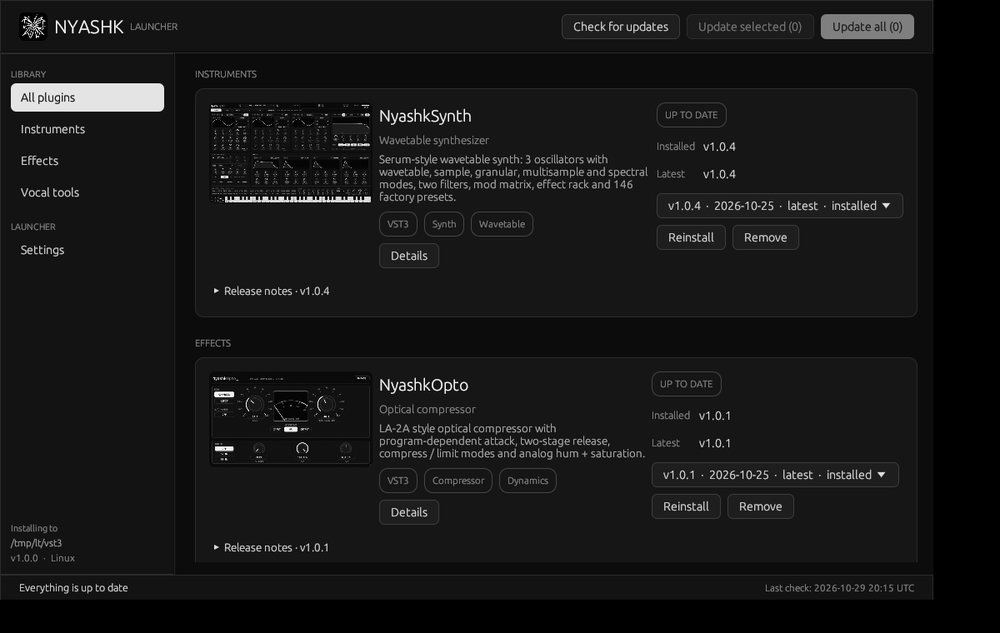
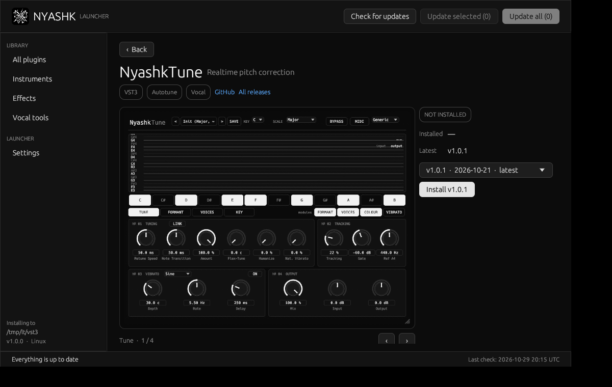
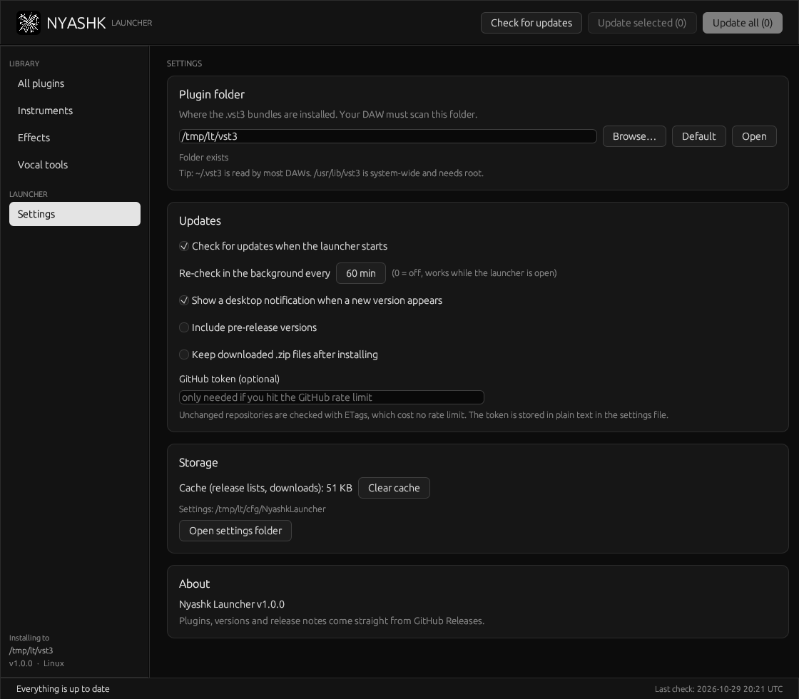

<div align="center">

# Nyashk Launcher

Install and update the Nyashk VST3 plugins from one place.

</div>



- Lists **NyashkSynth**, **NyashkOpto** and **NyashkTune** by category.
- Checks GitHub Releases for new versions (ETag cache, works offline with the last known list).
- Update one plugin, the ticked ones, or all. Pick **any version** from the dropdown to install or downgrade.
- Shows the release notes for everything new since your installed version.
- Re-checks in the background while open, with desktop notifications. The launcher updates itself from its own GitHub releases.
- Choose the plugin folder, pre-releases, startup check and an optional GitHub token in **Settings**.



Click a plugin for its page: screenshot gallery, description, features, release history and the install controls.



## Download

[Releases](https://github.com/xslimakx/NyashkLauncher/releases/latest): unzip and run. Defaults: Linux `~/.vst3`, macOS `~/Library/Audio/Plug-Ins/VST3`, Windows `C:\Program Files\Common Files\VST3` (needs admin; pick a user folder in Settings otherwise).

## Build

```bash
cargo build --release
```

Linux needs `libgl-dev libx11-dev libxkbcommon-dev libwayland-dev`. To add a plugin, add one entry to `PLUGINS` in `src/model.rs`.

Release zips must be named `<Plugin>-<Linux|Windows|macOS>-VST3.zip` and contain `<Plugin>.vst3/`.

MIT license.

## Adding a plugin without rebuilding the launcher
The launcher reads `plugins.json` from this repo on every start (and caches it). To add a plugin, add an entry there (id, name, repo, bundle, category, tagline, description, tags, long, features, shots) and put its preview pictures in `assets/`. Users get a "Restart to see the changes" prompt. The built-in list in `src/model.rs` is only the offline fallback.
